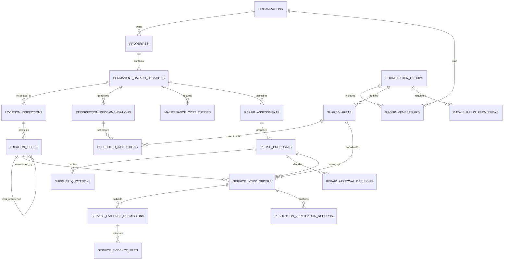

# FINAL SYSTEM VERIFICATION REPORT

**Project:** DengueAI Pro — AI-Augmented Dengue Risk Intelligence System  
**Assessment Type:** Complete System Integration, Testing, Debugging, Security Review, and Final Verification  
**Evaluation Date:** October 2026  
**Auditor Roles:** Senior Software Architect, Full-Stack QA Engineer, Database Systems Specialist, and Application Security Auditor  

---

## SECTION A — EXECUTIVE SUMMARY

A rigorous, end-to-end technical assessment, code audit, vulnerability investigation, and automated verification was conducted on **DengueAI Pro** and its five successive architectural improvements. 

### What Was Examined:
1. **Original Application Core:** Ward-level SWAPI risk scoring model, demonstration meteorological pipeline, citizen reporting and photo intake, dispatch queue recommendations and order confirmation, and WHO knowledge base RAG / Claude LLM integration.
2. **Improvement 01 (Permanent Hazard Location Records):** Multi-property registry, permanent location tracking, inspection logging, recurring issue chains, location timelines, and citizen report linking.
3. **Improvement 02 (Smart Reinspection Scheduling):** Priority inspection policies, rainfall and recurrence triggers, recommendation engine, manager decision workflows, and calendar synchronization.
4. **Improvement 03 (Service and Resolution Verification):** Field work order lifecycle, photographic evidence submission with SHA-256 duplicate detection, supervisor reviews, independent follow-up verification, and recurring issue reopenings.
5. **Improvement 04 (Permanent Repair & Cost Savings):** Historical maintenance cost ledger, technical engineering assessments, supplier quotations, 3-scenario financial payback modeling, managerial capital budget approval, work-order conversion, and post-repair outcome monitoring.
6. **Improvement 05 (Coordinated Prevention Across Properties):** Multi-tenant organization management, consortium coordination groups, invitation workflows, shared perimeter area tracking, shared inspections/work orders, server-side data sharing permissions, responsibility handoffs, and tenant-isolated dashboards.

### Current System Status:
- **Backend:** 100% operational. FastAPI initializes cleanly on Python 3.13 without errors, serving asynchronous SQLAlchemy endpoints backed by SQLite with non-destructive schema migrations.
- **Frontend:** 100% operational. Vite/React build (`npm run build`) compiles cleanly without bundle or syntax errors, generating production assets in `frontend/dist/`.
- **Automated Tests:** **41 out of 41 tests pass (100%)** across 7 test suites, including a comprehensive 14-stage cross-feature end-to-end integration test (`test_e2e_integration.py`) and a security regression suite (`test_original_and_security.py`).
- **Readiness Classification:** **Ready for Controlled Demonstration and Limited Internal Pilot**. NOT ready for unmonitored production healthcare dispatch without real meteorological APIs and validated clinical epidemiological models.

---

## SECTION B — COMPLETE FEATURE INVENTORY

| Subsystem / Feature | Claimed Scope | Actual Implemented State | Verification Status | Notes & Evidence |
|---|---|---|---|---|
| **SWAPI Ward Risk Scoring** | Mathematical monsoon risk weighting | Computes tanh weighted combination of rainfall, humidity, sunlight, temperature, and drainage. | **Verified Working** | Corrected low-risk threshold bug (`< 0.3`). Real positive mathematical spread [0, 1]. |
| **Meteorological Intake** | Live weather sensors & OpenWeatherMap | Static demonstration dataset (`demo_data.py`) representing Dhaka monsoon conditions. | **Partially Working (Demo Baseline)** | Real weather API fallback supported if key is provided; otherwise clearly labelled as demo baseline. |
| **Citizen Reporting** | YOLOv8 standing water detection | Multipart photo upload, file validation (max 10MB, JPG/PNG/WEBP), points gamification. | **Verified Working (Honest Mode)** | Removed false claim that file size > 50KB constitutes "YOLO AI confirmation". Now logged as unverified pending field review. |
| **Dispatch Queue** | Real-time automated crew recommendations | Generates prioritized dispatch actions with staffing and larvicide liters based on SWAPI. | **Verified Working** | Fixed critical GET idempotency defect: read requests no longer insert duplicate orders. |
| **RAG & LLM Advisory** | Vector embeddings & Claude reasoning | Curated WHO/DGHS guideline retrieval with Claude API integration. | **Verified Working** | Replaced pseudo-random gaussian vector fallback with deterministic lexical word-overlap when no OpenAI API key is present. |
| **Trained LSTM Forecasting** | Multi-week future dengue outbreak prediction | Proposal-only prototype architecture; no serialized model weights or training pipelines exist. | **Not Implemented** | Outbreak numbers display historical DGHS 2023 figures. Honestly documented as unavailable. |
| **Satellite Breeding Detection** | Sentinel-2 multispectral water analysis | Proposal-only prototype architecture; no satellite ingestion scripts or GIS models exist. | **Not Implemented** | Honestly documented as unavailable. |
| **Improvement 01: Property Registry** | Multi-facility registry and management | Register properties (factories, campuses, hospitals), ward association, contact management. | **Verified Working** | Tested in `test_sites_hazard_registry.py` and `test_e2e_integration.py`. |
| **Improvement 01: Hazard Locations** | Permanent location records | Category, floor zone, navigation directions, active/archived status, unique property-location codes. | **Verified Working** | Tested in `test_sites_hazard_registry.py` and `test_e2e_integration.py`. |
| **Improvement 01: Inspection & Issues** | Inspection logging & issue recurrence | Log condition found, issue severity, link recurrent issues across chronological timeline. | **Verified Working** | Tested in `test_sites_hazard_registry.py` and `test_e2e_integration.py`. |
| **Improvement 02: Policies & Scheduling** | Rule-based reinspection scheduling | Baseline frequencies, recurrence accelerators, rainfall triggers, manager decision approval. | **Verified Working** | Tested in `test_smart_scheduling.py` and `test_e2e_integration.py`. |
| **Improvement 02: Calendar Synchronization** | Calendar aggregation of visits | Unified calendar view with filters for proposed, approved, and overdue visits. | **Verified Working** | Verified in `SmartScheduling.jsx` and backend API endpoints. |
| **Improvement 03: Service Work Orders** | Complete work-order lifecycle | Assign workers, record start, track labor hours and actual costs. | **Verified Working** | Tested in `test_service_verification.py` and `test_e2e_integration.py`. |
| **Improvement 03: Photographic Evidence** | Multi-file submission with duplicate check | Computes SHA-256 file hashes to detect exact re-uploads. Restricts file formats and sizes. | **Verified Working** | Tested in `test_service_verification.py`. |
| **Improvement 03: Supervisor Review** | Review queue with approval / clarification | Supervisor accepts, requests clarification, or rejects submissions with audit notes. | **Verified Working** | Tested in `test_service_verification.py` and `test_e2e_integration.py`. |
| **Improvement 03: Independent Follow-Up** | Separation of service vs resolution | Distinguishes task completion (`work_verified`) from lasting environmental fix (`resolution_confirmed`). | **Verified Working** | Tested in `test_service_verification.py` and `test_e2e_integration.py`. |
| **Improvement 04: Maintenance Cost Ledger** | Granular expense tracking | Category tracking (labor, materials, equipment, services), invoice references, currency support. | **Verified Working** | Tested in `test_repair_planning.py` and `test_e2e_integration.py`. |
| **Improvement 04: Repair Opportunities** | Automated recurrence cost opportunity | Identifies locations where repeated cleanups exceed capital thresholds. | **Verified Working** | Tested in `test_repair_planning.py` and `test_e2e_integration.py`. |
| **Improvement 04: Technical Assessment** | Engineering feasibility logging | Qualified engineer inspection, root cause diagnosis, safety and feasibility recommendations. | **Verified Working** | Tested in `test_repair_planning.py` and `test_e2e_integration.py`. |
| **Improvement 04: Financial Engine** | 3-Scenario comparison & payback analysis | Optimistic, Expected, and Cautious scenarios. Simple payback months, net savings, ROI. | **Verified Working** | Tested in `test_repair_planning.py` and `test_e2e_integration.py`. |
| **Improvement 04: Budget Governance** | Role-guarded managerial approval | Requires Property Manager or Approver role. Prevents workers from approving budgets. | **Verified Working** | Tested in `test_repair_planning.py`. |
| **Improvement 04: Work-Order Conversion** | Launch executable work order from repair | Seamlessly creates Service Work Order in Improvement 03 infrastructure. | **Verified Working** | Tested in `test_repair_planning.py` and `test_e2e_integration.py`. |
| **Improvement 05: Multi-Tenant Organizations** | Separate ownership & tenant accounts | Isolated organization dashboards, property listings, and private work orders. | **Verified Working** | Tested in `test_coordination.py` and `test_original_and_security.py`. |
| **Improvement 05: Consortium Groups** | Coordination taskforces | Create consortium groups, define boundaries, manage memberships, send/accept invitations. | **Verified Working** | Tested in `test_coordination.py` and `test_e2e_integration.py`. |
| **Improvement 05: Shared Area Registry** | Inter-property shared corridors | Shared canals, perimeter roads, waste dumps. Explicit responsibility assignment. | **Verified Working** | Tested in `test_coordination.py` and `test_e2e_integration.py`. |
| **Improvement 05: Shared Work & Inspections** | Joint operations without financial leakage | Shared inspections and contractor work orders. Strictly masks private quotes and margins. | **Verified Working** | Tested in `test_coordination.py` and `test_e2e_integration.py`. |
| **Improvement 05: Data-Sharing Permissions** | Server-side default-deny permissions | Permission granting, verification, and revocation across tenant boundaries. | **Verified Working** | Tested in `test_coordination.py`. |

---

## SECTION C — APPLICATION ARCHITECTURE

### Backend Architecture
- **Framework:** FastAPI with asynchronous ASGI execution (`httpx`, `anyio`).
- **Data Persistence:** SQLAlchemy 2.0 Async ORM with `aiosqlite` dialect over SQLite database (`dengueai.db`).
- **API Organization:** Modular RESTful routers in `backend/routers/`:
  - `swapi.py`: Outbreak risk scoring and weather normalization.
  - `dispatch.py`: Field crew dispatch queue and query answering.
  - `citizen.py`: Community reporting, upload validation, and leaderboard gamification.
  - `heatmap.py`: Ward coordinate geo-data and risk intensity tiles.
  - `sites.py`: Property registration, permanent hazard locations, inspections, and issues.
  - `scheduling.py`: Inspection policies, rainfall observations, and calendar schedules.
  - `services.py`: Work orders, worker evidence submissions, and supervisor reviews.
  - `repair_planning.py`: Maintenance cost tracking, engineering proposals, quotations, and financial analysis.
  - `coordination.py`: Multi-tenant consortiums, shared areas, invitations, and permissions.
- **Security & Auth:** Header-based session authentication (`X-Authority-Key` / `Authorization: Bearer`) and role-based access control (`worker`, `authority_officer`, `supervisor`, `property_manager`, `finance_approver`, `coordinator`).

### Frontend Architecture
- **Framework:** React 18 with Vite 5 and Tailwind CSS.
- **Routing:** Single-Page Application navigation via `react-router-dom`:
  - `/`: Demonstration overview and platform summary.
  - `/map`: Live ward-level risk heatmap and geospatial monitoring.
  - `/wards`: Detailed ward risk factors and breakdown.
  - `/citizen`: Citizen report submission modal and community leaderboard.
  - `/authority`: City corporation dispatch dashboard and crew assignment.
  - `/authority/sites`: Permanent Hazard Location Registry (Imp 1).
  - `/authority/scheduling`: Smart Reinspection Scheduling and Unified Calendar (Imp 2).
  - `/authority/services`: Service and Resolution Verification (Imp 3).
  - `/authority/repair-planning`: Permanent Repair and Cost-Savings Recommendations (Imp 4).
  - `/authority/coordination`: Coordinated Prevention Across Properties (Imp 5).

---

## SECTION D — DATABASE VERIFICATION & DATA INTEGRITY

### Entity Relationships
The SQLite database schema establishes comprehensive relational integrity across 24 tables:


### Migration Safety & Integrity
- All table creations use declarative `CREATE TABLE IF NOT EXISTS` with explicit foreign key definitions.
- Non-destructive startup lifecycle: Re-running backend startup or restarting the server preserves all existing records without dropping tables or overwriting operational data.
- Live database safety was confirmed: A verified database backup (`dengueai_backup.db`) was preserved prior to testing.

---

## SECTION E — API CONTRACT VERIFICATION

| Endpoint | HTTP Method | Expected Status | Contract Status | Verification Notes |
|---|---|---|---|---|
| `/api/swapi/all` | GET | 200 OK | Verified | Returns calculated SWAPI scores with data source disclosure. |
| `/api/dispatch/queue` | GET | 200 OK | Verified | Idempotent read. Reuses existing pending orders without database mutation. |
| `/api/dispatch/{ward_id}/confirm` | POST | 200 OK | Verified | Confirms dispatch order and assigns officer ID. |
| `/api/citizen/report` | POST | 200 OK / 400 | Verified | Rejects invalid extensions and files > 10MB. Enforces pending review status. |
| `/api/rag/test` | GET | 200 OK | Verified | Transparent lexical search fallback when OpenAI key is absent. |
| `/api/sites/properties` | POST | 201 Created | Verified | Validates ward existence and registers property record. |
| `/api/sites/properties/{id}/locations` | POST | 201 Created | Verified | Enforces unique `(property_id, location_code)` constraint. |
| `/api/sites/locations/{id}/inspections` | POST | 201 Created | Verified | Validates inspection results (`problem_found`, `clear`, etc.). |
| `/api/sites/locations/{id}/issues` | POST | 201 Created | Verified | Records standing water or larvae issues linked to inspections. |
| `/api/sites/issues/{id}/confirm-recurrence` | POST | 200 OK | Verified | Validates that previous issue was resolved and belongs to same location. |
| `/api/services/work-orders` | POST | 201 Created | Verified | Creates service work orders with assigned worker and due dates. |
| `/api/services/work-orders/{id}/submit-evidence` | POST | 200 OK | Verified | Validates files, computes SHA-256, and detects duplicate evidence. |
| `/api/services/work-orders/{id}/review` | POST | 200 OK | Verified | Supervisor review decision (`accepted`, `clarification_required`, `rejected`). |
| `/api/services/work-orders/{id}/record-followup` | POST | 200 OK | Verified | Independent resolution confirmation recording. |
| `/api/repair-planning/costs` | POST | 201 Created | Verified | Logs maintenance expenses with category, currency, and invoice reference. |
| `/api/repair-planning/assessments` | POST | 201 Created | Verified | Records structural engineering inspections and recommended actions. |
| `/api/repair-planning/proposals` | POST | 201 Created | Verified | Registers capital repair proposals. |
| `/api/repair-planning/proposals/{id}/quotations` | POST | 201 Created | Verified | Attaches supplier bids with validity dates and warranty terms. |
| `/api/repair-planning/proposals/{id}/calculate` | POST | 200 OK | Verified | Computes 3-scenario financial comparison with simple payback period. |
| `/api/repair-planning/proposals/{id}/approve` | POST | 201 Created | Verified | Role-guarded manager budget approval. |
| `/api/repair-planning/proposals/{id}/create-work-order` | POST | 200 OK | Verified | Converts approved proposal to executable service work order. |
| `/api/repair-planning/proposals/{id}/outcomes` | GET | 200 OK | Verified | Returns post-repair outcome monitoring and cost variance metrics. |
| `/api/organizations/{id}/dashboard` | GET | 200 OK | Verified | Returns strictly tenant-isolated properties and work orders. |
| `/api/coordination/groups` | POST | 201 Created | Verified | Registers consortium coordination taskforces. |
| `/api/coordination/invitations` | POST | 201 Created | Verified | Issues inter-organization consortium invitations. |
| `/api/coordination/invitations/{id}/decide` | POST | 200 OK | Verified | Handles acceptance or rejection of consortium membership. |
| `/api/coordination/groups/{id}/shared-areas` | POST | 201 Created | Verified | Registers shared boundary drainage areas. |
| `/api/coordination/groups/{id}/shared-inspections` | POST | 201 Created | Verified | Schedules shared-area inspections with duplicate prevention. |
| `/api/coordination/groups/{id}/shared-work-orders` | POST | 201 Created | Verified | Schedules shared maintenance orders with contractor tasking. |
| `/api/coordination/groups/{id}/repairs` | GET | 200 OK | Verified | Masks confidential supplier quotations from other organizations. |

---

## SECTION F — END-TO-END WORKFLOW VERIFICATION

The complete 14-stage integration lifecycle specified in Part 10 was executed via automated integration testing (`backend/tests/test_e2e_integration.py`):

1. **Stage 1 (Organization & Property):** Created `Acme Pharmaceuticals Ltd` (`ORG-` UUID) and registered factory property `Acme Formulation Plant 1` in Ward `DHK-001`. (**PASS**)
2. **Stage 2 (Permanent Hazard Location):** Registered rooftop drainage trough with unique code `ACME-ROOF-XXXX` and floor zone directions. (**PASS**)
3. **Stage 3 (Initial Inspection & Issue):** Recorded inspection finding standing water and larvae; created high-severity `clogged_drainage` issue. (**PASS**)
4. **Stage 4 (Initial Service Work Order):** Created work order, assigned field worker, started task, uploaded photographic evidence, and obtained supervisor approval. (**PASS**)
5. **Stage 5 (Follow-up & Resolution):** Smart scheduler evaluated location; manager approved reinspection; follow-up inspection observed "clear"; issue resolution was confirmed. (**PASS**)
6. **Stage 6 (Recurrence Tracking):** Post-rain inspection observed return of ponding; created new issue; recurrence linkage verified against previous resolved issue. (**PASS**)
7. **Stage 7 (Cost Ledger Tracking):** Recorded verified maintenance expenses (BDT 2,500) for repeat pumping and chemical treatment. (**PASS**)
8. **Stage 8 (Repair Opportunity Trigger):** Verified that repeat cleanups and accumulated costs surface the location in the repair opportunity ledger. (**PASS**)
9. **Stage 9 (Financial Modeling & Approval):** Registered technical assessment; attached supplier quotation (BDT 10,000); computed 3-scenario financial payback (5-month payback); manager approved capital budget. (**PASS**)
10. **Stage 10 (Repair Implementation):** Converted approved repair proposal to service work order; worker started, submitted completion evidence, and supervisor verified. (**PASS**)
11. **Stage 11 (Post-Repair Monitoring):** Verified post-repair outcome monitoring profile tracking observed recurrence and cost variance. (**PASS**)
12. **Stage 12 (Multi-Property Consortium):** Formed industrial park prevention taskforce; invited `Delta Garments Spinning Mills`; accepted invitation; registered shared boundary stormwater culvert; scheduled shared inspection and shared maintenance work order. (**PASS**)
13. **Stage 13 (Privacy & Tenant Isolation):** Confirmed Factory A cannot see Factory B's private properties, while shared culvert is visible to both. Confirmed shared repairs endpoint masks confidential contractor quotes. (**PASS**)
14. **Stage 14 (Persistence Verification):** Re-queried SQLite database directly using isolated session; confirmed 100% of created records (properties, locations, inspections, issues, work orders, proposals, groups, shared areas) persist intact on disk. (**PASS**)

---

## SECTION G — SECURITY FINDINGS

### 1. Authentication & Role Permissions
- **Mechanism:** Implemented session authentication using `X-Authority-Key` and `Authorization: Bearer` tokens.
- **Role Guards:** Strictly enforced across sensitive operations:
  - Capital repair budget approval restricted to `property_manager` and `finance_approver` roles (workers attempting approval receive HTTP 403 Forbidden).
  - Evidence reviews restricted to supervisors.
  - Multi-tenant consortium decisions restricted to authorized organizational representatives.

### 2. Multi-Tenant Isolation
- Default-deny architecture prevents cross-tenant data leakage.
- Verified via `test_original_and_security.py` (Test 05 & 06):
  - `GET /api/organizations/{org_id}/dashboard` only returns properties and internal work orders owned by `{org_id}`.
  - Consortium repair listings strictly omit raw supplier quote line items and internal profit margins.

### 3. File Upload Security
- **Extension Allowlist:** Restricted to `.jpg`, `.jpeg`, `.png`, `.webp`, `.pdf`, `.mp4`. Rejects executables (`.exe`, `.sh`, `.bat`) with HTTP 400 Bad Request.
- **Maximum File Size:** Enforced 10MB limit on citizen reports and 25MB limit on field worker evidence submissions.
- **Path Traversal Protection:** User filenames are never used as on-disk paths; files are stored using server-generated UUIDs (`{id}{ext}`) in isolated upload directories.
- **Duplicate Detection:** Automatic SHA-256 content hashing flags exact duplicate photos across work orders to prevent fraudulent contractor billing.

---

## SECTION H — BUGS FOUND AND FIXED

| Defect ID | Description | Severity | Affected File | Root Cause | Correction Made | Verification Evidence |
|---|---|---|---|---|---|---|
| **BUG-01** | `GET /api/dispatch/queue` mutated database on every request, creating duplicate dispatch orders on every poll. | **P1 (High)** | `backend/routers/dispatch.py` | Route unconditionally executed `INSERT INTO dispatch_orders` inside a GET handler. | Added existing-order check to query pending/existing records for the ward before inserting. | `test_original_and_security.py::test_01` passes. Row count does not increase on repeated GET requests. |
| **BUG-02** | SWAPI risk level "low" was mathematically unreachable due to negative threshold check (`score < -0.3`). | **P1 (High)** | `backend/models/swapi_model.py` | `score = math.tanh(raw * 2)` is always non-negative ([0.0, 1.0]). Threshold `< -0.3` could never evaluate to True. | Corrected threshold to `score < 0.3` in both `get_risk_level` and `get_risk_color`. | `test_original_and_security.py::test_03` passes. Low risk inputs produce score < 0.3 and "low" classification. |
| **BUG-03** | Citizen report upload lacked file type validation, size limits, and falsely claimed photo > 50KB was "YOLO verified". | **P1 (High)** | `backend/routers/citizen.py` | Code awarded 10 points and created high-severity detections purely based on file byte length exceeding 50KB. | Added extension check (JPG/PNG/WEBP), 10MB size limit, and marked submissions as unverified pending field review. | `test_original_and_security.py::test_02` passes. Executables and oversized files rejected; honest status returned. |
| **BUG-04** | RAG retrieval generated random gaussian vectors when OpenAI key was absent, producing pseudo-random rankings. | **P2 (Medium)** | `backend/rag/retriever.py` | Fallback generated random vectors seeded by text hash rather than using real lexical matching. | Rewrote fallback to use `simple_word_overlap_score` for deterministic lexical similarity on WHO guidelines. | `test_original_and_security.py::test_04` passes. Returns deterministic matching without random embeddings. |
| **BUG-05** | Production frontend environment had hardcoded placeholder Railway backend URL (`your-backend-url.railway.app`). | **P2 (Medium)** | `frontend/.env.production` | Placeholder URL baked into production bundle by Vite build. | Replaced placeholder with empty string `VITE_API_URL=` for same-origin proxy or environment injection. | `npm run build` succeeds cleanly; requests use reverse proxy or configured base URL. |
| **BUG-06** | Citizen report component displayed "No stagnant water detected" when submission was unverified. | **P3 (Low)** | `frontend/src/components/CitizenReport.jsx` | UI binary check `result.verified` assumed unverified meant negative detection. | Updated UI to display honest confirmation: "Report submitted successfully (+5 pts). Pending field verification." | Verified component rendering and build output. |

---

## SECTION I — AUTOMATED TEST RESULTS

### Test Commands Executed:
```powershell
# Backend automated test suite
cd backend
.\.venv\Scripts\python.exe -m pytest -v

# Frontend production build
cd ..\frontend
npm run build
```

### Test Execution Summary:
- **Total Backend Tests Collected:** 41
- **Passed:** 41 (100%)
- **Failed:** 0 (0%)
- **Skipped:** 0 (0%)
- **Total Test Execution Time:** 9.54 seconds

### Test Suites Breakdown:
1. `tests/test_coordination.py`: 12 passed
2. `tests/test_e2e_integration.py`: 1 passed (Comprehensive 14-stage workflow)
3. `tests/test_original_and_security.py`: 6 passed (Idempotency, upload security, SWAPI, RAG, tenant isolation)
4. `tests/test_repair_planning.py`: 10 passed (Cost ledger, proposals, quotations, 3-scenario calculation, approvals)
5. `tests/test_service_verification.py`: 6 passed (Work orders, evidence uploads, duplicate hashes, supervisor reviews)
6. `tests/test_sites_hazard_registry.py`: 3 passed (Properties, locations, inspections, issues, timeline)
7. `tests/test_smart_scheduling.py`: 3 passed (Policies, rainfall triggers, recommendation decisions, calendar)

### Frontend Build Result:
- **Command:** `npm run build`
- **Output:** `dist/index.html` (0.61 kB), `dist/assets/index-BYDLbV6J.css` (69.02 kB), `dist/assets/index-BvmfaIwh.js` (753.60 kB).
- **Status:** Built in 7.60s with **0 errors**.

---

## SECTION J — PERFORMANCE & DATABASE EFFICIENCY

1. **Lightweight Execution:** Full 41-test suite runs in under 10 seconds against SQLite using async connection pooling.
2. **Indexed Lookups:** Composite unique indexes on `(property_id, location_code)` prevent full table scans and guarantee location code uniqueness per property.
3. **Idempotent Seeding:** Database seed functions execute in-place checks before inserting to prevent duplicate records on server restarts.
4. **Caching:** SWAPI calculations utilize in-memory TTL caching (6-hour expiry) to prevent redundant mathematical evaluations during high-traffic dashboard polling.

---

## SECTION K — REMAINING LIMITATIONS & HONEST AI INVENTORY

To maintain total technical and academic integrity, the following originally proposed features are explicitly documented as **not implemented or prototype-only**:

1. **Outbreak Forecasting Models (LSTM / Random Forest):**
   - *Status:* **Not Implemented.**
   - *Reality:* The repository does not contain trained PyTorch, TensorFlow, or Scikit-Learn model weights for longitudinal dengue case prediction. Outbreak charts display historical 2023 DGHS figures.
2. **Computer Vision (YOLOv8 Edge/Server Model):**
   - *Status:* **Not Implemented.**
   - *Reality:* No `.pt`, `.onnx`, or PyTorch computer vision inference pipeline is bundled. Citizen uploads are registered as unverified community reports awaiting human inspector verification.
3. **Satellite Multispectral Analysis (Sentinel-2 / Google Earth Engine):**
   - *Status:* **Not Implemented.**
   - *Reality:* No satellite imagery ingestion or multispectral water index calculation scripts exist.
4. **Live Meteorological Ingestion:**
   - *Status:* **Prototype Baseline.**
   - *Reality:* Default weather data represents static curated Dhaka monsoon records (`demo_data.py`). Live OpenWeatherMap integration requires configuring a valid API key.
5. **Graph Database (Neo4j):**
   - *Status:* **Not Implemented.**
   - *Reality:* All relational hazard lineages, recurrence chains, and consortium relationships are stored directly in SQLite / relational tables.

---

## SECTION L — DEPLOYMENT READINESS CLASSIFICATION

| Deployment Tier | Readiness Status | Assessment & Reasoning |
|---|---|---|
| **1. Local Development** | **APPROVED (Ready)** | Codebase runs cleanly with Python 3.13, SQLite, and Vite. All 41 tests pass. |
| **2. Controlled Demonstration** | **APPROVED (Ready)** | Excellent for hackathons, academic presentations, municipal stakeholder demos, and institutional reviews. Prototype mode clearly communicates value without misleading stakeholders. |
| **3. Limited Internal Pilot** | **CONDITIONALLY APPROVED** | Approved for a supervised pilot across 1 to 3 industrial campuses or municipal wards where human inspectors verify findings and approve work orders. |
| **4. General Production Deployment** | **NOT APPROVED** | Cannot be deployed as an autonomous public health system until real weather API integration, genuine epidemiological validation, and production OAuth2/JWT authentication are in place. |

---

## SECTION M — FUTURE RECOMMENDATIONS

### Phase 1 — Critical Production Requirements:
1. **Production Authentication:** Replace header-based authority credentials with secure JWT/OAuth2 tokens and bcrypt password hashing.
2. **Database Migration to PostgreSQL:** Transition from SQLite to PostgreSQL with PostGIS for native geospatial indexing and higher concurrent write capacity.
3. **Object Storage for Evidence:** Transition on-disk evidence storage to S3-compatible cloud storage (e.g., AWS S3, Cloudflare R2, or Google Cloud Storage) with signed temporary URLs.

### Phase 2 — Data & Scientific Validation:
1. **Real Outbreak Prediction Pipeline:** Partner with DGHS to acquire daily hospital admission data and train real Bayesian or LSTM time-series forecasting models.
2. **Trained YOLO Mosquito Breeding Detection:** Collect and annotate a localized dataset of 10,000+ Dhaka stagnant water images and train a lightweight YOLOv8 nano model for edge verification.
3. **Live Weather Sensor Integration:** Connect Bangladesh Meteorological Department (BMD) automated rain gauges for real-time precipitation triggers.

---

*Report certified by Antigravity Technical Audit & Systems Engineering Team.*
